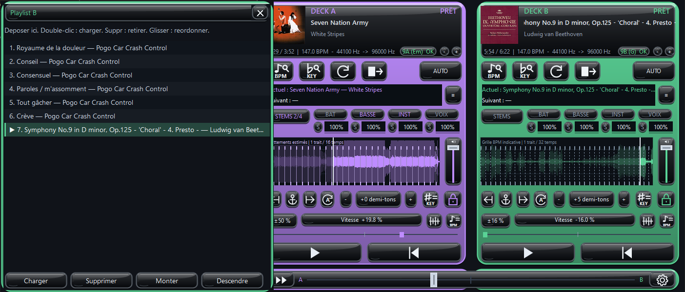

# DJ Decks pour foobar2000 (`foo_dj`)

[English](README.md) · [Historique](CHANGELOG.md) · [Compilation](docs/BUILD.md) · [Limites connues](docs/KNOWN_ISSUES.md) · [Discussion sur Hydrogenaudio](https://hydrogenaudio.org/index.php/topic,130167.0.html)

Deux platines indépendantes dans foobar2000, avec mixage et formes d’onde.
**0.34.1-beta.1 : paquets bêta x64 et x86. Les stems restent expérimentaux.**

Nouveautés : [cache des stems](docs/STEM_CACHE.md), [ReplayGain et scrobbling facultatif](docs/SCROBBLING_REPLAYGAIN.md), [formats de playlist et transferts A/B](docs/PLAYLISTS.md).

Nouveautés depuis la dernière publication : [préécoute casque configurable](docs/HEADPHONE_CUE.md), [extraits de playlist et forme d’onde complète cliquable](docs/PLAYLIST_PREVIEW.md), [suppression optionnelle des silences et préchargement](docs/SILENCE_TRIM.md), déplacement multiple avec Maj et alternance AUTO préservée lors des déplacements dans le morceau.

## ⬇ Télécharger l’extension

**[Télécharger DJ Decks 0.34.1-beta.1 pour Windows x64](https://github.com/thomasandro/foobar-dj-decks/releases/download/v0.34.1-beta.1/foo_dj-0.34.1-beta.1-win-x64.fb2k-component)**

**[Télécharger en 32 bits (x86)](https://github.com/thomasandro/foobar-dj-decks/releases/download/v0.34.1-beta.1/foo_dj-0.34.1-beta.1-win-x86.fb2k-component)**

Fichier installable `.fb2k-component` pour foobar2000 2.x : x64 ou x86 selon votre installation.
Dans foobar2000 : **Préférences → Composants → Installer…**, puis redémarrer.

[Télécharger la bêta et les sources correspondantes](https://github.com/thomasandro/foobar-dj-decks/releases/tag/v0.34.1-beta.1)
Le développement a été assisté par IA ; les revues du moteur audio et des threads
ainsi que les retours reproductibles sont bienvenus.

*Capture fournie par l’utilisateur de l’interface 0.24 : stems, couleurs des platines et titre de playlist intégré.*

Merci à [StyxCrosser](https://hydrogenaudio.org/index.php/topic,130167.msg1090621.html#msg1090621)
pour l’idée des playlists flottantes et ses retours sur l’interface et la libération des fichiers.

## Fonctions

- Chargement, lecture/pause et positionnement indépendants ; bouton commun pour les deux états.
- Volumes séparés, crossfader à puissance constante ou linéaire, variations de gain lissées.
- Formes d’onde avec zoom, clic pour se déplacer et indication de la partie déjà jouée.
- Pochettes ; titre et artiste sur deux lignes défilantes ; interface français/anglais.
- Affichage du BPM renseigné dans les tags ; plages de vitesse au choix : ±8 %, ±16 % ou ±50 %.
- Mode vinyle ou tempo avec tonalité préservée par SoundTouch.
- Transposition indépendante de −12 à +12 demi-tons, sans modifier le tempo.
- Calage harmonique automatique : même tonalité ou relative compatible, transposition la plus proche.
- Thème brillant ou plat/sobre, huit couleurs indépendantes par platine, boutons noirs avec survol/clic et infobulles. [Apparence](docs/APPEARANCE.md).
- Bandeau inférieur compact : transport commun, crossfader et engrenage Réglages (langue, thème et couleurs).
- Bouton Arrêter/libérer par platine ; Lecture rouvre le fichier à la position conservée.
- Tonalité Camelot et classique, par exemple 8A (Am), avec indicateur de compatibilité coloré.
- Calcul BPM/tonalité via les composants facultatifs foo_bpm / foo_musical_key,
  actualisation sans recharger le son. [Détails](docs/DECK_ANALYSIS.md).
- Calage BPM et SYNC avec équivalents moitié/double : vitesse admissible la plus proche. [Détails](docs/TEMPO_MATCHING.md).
- Repères estimés/manuels continus ; grille indicative en pointillés si la détection est incertaine.
- Réglage manuel de grille, « Temps ici » et retour Auto, mémorisés par fichier/sous-piste.
- Morceaux et positions restaurés en pause après fermeture normale.
- Playlists sauvegardées par platine, aperçu Actuel/Suivant et deux fenêtres flottantes assorties aux decks.
- Dépôt de plusieurs morceaux, réorganisation/suppression multiple et chargement par double-clic. [Guide](docs/PLAYLISTS.md).
- AUTO : enchaînement indépendant ou alternance A/B, fondus de 0 à 30 s, courbe puissance constante/linéaire. [Utilisation](docs/AUTOMATIC_PLAYBACK.md).
- Glisser-déposer natif foobar/Explorateur ; formats texte compatibles Smooth Playlist/Browser facultatifs.

- **Séparation locale en quatre stems — expérimentale** : batterie, basse, instruments et voix, avec activation, volume 0–100 % et Solo par stem sur chaque platine. [Guide](docs/STEMS.md).
- Accélération NVIDIA CUDA automatique et repli CPU, progression, annulation et cache réutilisable. La préparation se termine avant utilisation.
- Titre et croix des playlists intégrés au thème, sans barre Windows grise.

## Moteur de stems facultatif — expérimental

Le composant fonctionne sans Python. Pour les stems, installer Python 3.10–3.12,
télécharger le [ZIP de l’installateur du moteur](https://github.com/thomasandro/foobar-dj-decks/releases/download/v0.34.1-beta.1/foo_dj-stems-engine-0.34.1-beta.1.zip), le décompresser puis
lancer `./install-stems.ps1 -DownloadModel` dans PowerShell. Les dépendances et le
modèle htdemucs sont téléchargés séparément. CUDA est choisi s’il est disponible,
avec retour au CPU en cas d’échec. `-CPUOnly` installe uniquement le moteur CPU.
Les utilisateurs du moteur CPU existant doivent relancer l’installateur pour CUDA.
Le son reste local et les morceaux ne sont pas modifiés. [Installation et limites](docs/STEMS.md).

## Installation

Windows, foobar2000 2.x (architecture x64 ou x86 correspondante), Default User Interface. Les essais de développement
ont été faits avec foobar2000 2.26.3 preview du 8 novembre 2026. Les autres versions
2.x ne sont pas encore validées. Choisir le paquet correspondant à foobar (x64 ou x86). Les tests natifs passent sur les deux architectures ; les retours en conditions réelles sur x86 restent attendus. Aucune version ARM64/macOS ni intégration native
Columns UI n’est fournie.

Pour le premier essai, utiliser un profil portable séparé. Installer
`foo_dj-0.34.1-beta.1-win-x64.fb2k-component` via
**Préférences → Composants → Installer…**, puis redémarrer. Dans l’édition de disposition
de Default UI, ajouter **DJ Decks** (Utilitaires). Un grand panneau est préférable ;
commencer vers 900 × 650 px. WebView2, SMP et Smooth Browser ne sont pas nécessaires. Le composant utilise
`shared.dll` fourni par foobar et le runtime C++ Microsoft. Si Windows signale
MSVCP140/VCRUNTIME140 manquant, utiliser le
[runtime C++ x64 officiel Microsoft](https://learn.microsoft.com/en-us/cpp/windows/latest-supported-vc-redist).

La préversion comprend le paquet installable, les sources complètes correspondantes
et les sommes SHA-256. L’utilisateur confirme l’installation x64, la lecture réelle et la sauvegarde/restauration. Le paquet bêta a également été installé et son fonctionnement confirmé par l’utilisateur ; le retour x86 est attendu. Les scripts créent les paquets locaux dans `dist/`.

## Utilisation

Glisser des morceaux sur chaque platine ajoute toute la sélection à sa playlist ; une platine vide charge le premier en pause.
Le bouton commun inverse les deux états : lecture des deux, pause des deux, ou échange
de la platine en lecture si une seule joue. Régler volumes et crossfader ; aucun
limiteur de sortie n’est prévu.

Molette sur la vitesse : pas de 0,1 % ; Maj+molette : 0,01 % ; clic droit : 0 %.
« Tonalité fixe : OUI » conserve la hauteur ; le mode vinyle la fait varier.
« BPM = A/B » égale le BPM effectif de l’autre platine, dans la plage choisie sur cette platine et avec
deux tags valides. « SYNC = A/B » ajuste aussi la position de la platine choisie,
sans changer lecture/pause. C’est un calage ponctuel, sans suivi continu ni détection
du premier temps de mesure. Les pointillés n’attestent pas un calage et ne valident
pas une grille automatique pour SYNC.

Cliquer sur ±16 % pour choisir ±8 %, ±16 % ou ±50 %. Une plage plus étroite
ramène la vitesse à sa limite si nécessaire. Le choix est mémorisé par platine.
Les boutons de transposition −/+ changent la hauteur par demi-ton ; le centre remet
à zéro, sans changer le tempo. La tonalité affichée suit cette transposition.
Le bouton note/flèche cale la tonalité sur l’autre platine, ou sur sa relative compatible
si les modes majeur/mineur diffèrent. Activer la tonalité fixe si la vitesse vinyle est modifiée.
Survoler les icônes pour afficher leur fonction dans la langue choisie.
L’analyse libère le fichier et met la platine en pause pour permettre l’écriture des tags.
Après validation des résultats dans le plugin, Lecture reprend à la position conservée.
Actualiser tags affiche les BPM brut/effectif et la tonalité relus.
Vert/OK : association Camelot habituelle ; orange/~ : autre association ; gris/? :
tag inconnu ou vitesse vinyle non neutre. Cela reste un guide pour l’oreille.

Pour une grille manuelle : pause, zoom, clic sur une attaque, puis « Temps ici ».
Décaler de ±10 ms avec les boutons ou à la molette ; Maj donne un pas de 1 ms.
« Auto » retire le réglage du morceau. SYNC utilise les grilles manuelles.
Un décalage de grille ne corrige ni un mauvais BPM ni les variations de tempo.

## Limites et données

Les lenteurs observées préexistaient au travail sur le composant selon l’utilisateur ; elles ne constituent pas un blocage démontré propre à DJ Decks. Les retours de bêta restent bienvenus. La détection des battements peut refuser de vrais morceaux. Pas de
égaliseur, de limiteur, de boucles ou de suivi de synchronisation.

Les platines utilisent les décodeurs installés et la sortie configurée, mais suivent
leur propre transport : ne pas supposer une intégration avec les DSP, scrobbles et
informations « en cours » du lecteur principal. Un périphérique exclusif peut être
en conflit avec la lecture principale. Voir les [limites connues](docs/KNOWN_ISSUES.md).

Les fichiers de profil `foo_dj-session.json` et `foo_dj-grids.json` contiennent des
chemins de musique personnels et des réglages. Ne pas les publier sans les expurger.
La langue reste dans la configuration foobar. La recherche de pochettes suit les
fournisseurs configurés dans foobar, qui peuvent avoir leur propre activité réseau.
DJ Decks n’ajoute ni télémétrie ni recherche automatique de mises à jour.

Les rapports utiles précisent les versions, l’architecture, la sortie audio et des
étapes de reproduction, si possible dans un profil vierge. Ne pas joindre de fichiers
musicaux ou de sessions personnelles par défaut. [Licences](THIRD_PARTY_NOTICES.md).

### Playlists et lecture automatique

Déposer plusieurs morceaux ajoute toute la sélection à la liste de la platine.
Sur une platine vide, le premier est chargé en pause. **≡** ou l’aperçu Actuel/Suivant
ouvre sa fenêtre flottante ; double-clic pour charger, Suppr pour retirer une entrée.
Le menu **AUTO** règle l’enchaînement ou l’alternance A/B et les fondus. Ces modes
restent expérimentaux ; l’enchaînement sur une seule platine n’est pas sans coupure.
