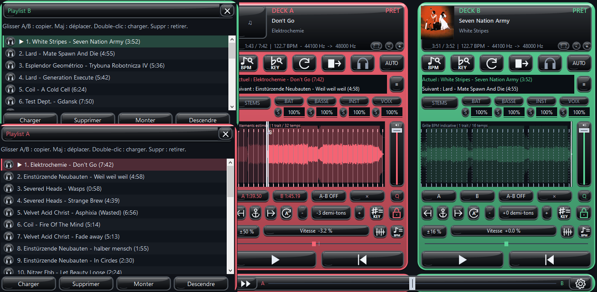

# DJ Decks for foobar2000 (`foo_dj`)

[Français](README.fr.md) · [Changelog](CHANGELOG.md) · [Build](docs/BUILD.md) · [Known issues](docs/KNOWN_ISSUES.md) · [Hydrogenaudio discussion](https://hydrogenaudio.org/index.php/topic,130167.0.html)

Two independent DJ-style decks inside foobar2000, with a mixer and waveforms.
**0.43.0-beta.1: x64 and x86 beta packages. Stems remain experimental.**

Also available: [stem cache](docs/STEM_CACHE.md), [ReplayGain and optional scrobbling](docs/SCROBBLING_REPLAYGAIN.md), [custom playlist formats and A/B transfers](docs/PLAYLISTS.md).

New in this beta: [persistent A/B loops and Q grid snapping](docs/AB_LOOPS.md), [six-tab settings window](docs/SETTINGS.md), more responsive tooltips and corrected dark-label contrast, and [save/load session files](docs/SESSION_FILES.md).

New since 0.37: **distribute the active foobar playlist alternately to A and B**, with a recovery snapshot before replacement, and **Ctrl+A** to select every track in either deck playlist. See [playlist workflow](docs/PLAYLISTS.md).

New since 0.38.1: **master limiter and clipping indicator** ([guide](docs/MASTER_LIMITER.fr.md)), **Escape to hide playlists**, **Empty list** and selectable **BPM analyser** (Auto / foo_smart_tempo / foo_bpm). [Details](docs/BPM_ANALYSERS.md).

New in 0.43.0: **temporary MIDI jog speed correction**, independently selectable for each deck alongside seek mode. Adjustable maximum ±0.5–8%, automatic return to the unchanged base tempo, with existing key lock. Installed x64 release confirmed working on my setup; x86 has not been tested in foobar by me. [MIDI setup and limits](docs/MIDI.md).

## ⬇ Download the component

**[Download DJ Decks 0.43.0-beta.1 for Windows x64](https://github.com/thomasandro/foobar-dj-decks/releases/download/v0.43.0-beta.1/foo_dj-0.43.0-beta.1-win-x64.fb2k-component)**

**[Download the 32-bit (x86) component](https://github.com/thomasandro/foobar-dj-decks/releases/download/v0.43.0-beta.1/foo_dj-0.43.0-beta.1-win-x86.fb2k-component)**

[Complete matching sources (x64 and x86)](https://github.com/thomasandro/foobar-dj-decks/releases/download/v0.43.0-beta.1/foo_dj-0.43.0-beta.1-source.zip)

Installable `.fb2k-component` package: choose x64 or x86 to match foobar2000 2.x.
In foobar2000: **Preferences → Components → Install…**, then restart.

[Download the beta and matching source](https://github.com/thomasandro/foobar-dj-decks/releases/tag/v0.43.0-beta.1)
Development was AI-assisted; audio and threading review and reproducible bug reports
are particularly welcome.

*User-supplied screenshot: 0.38.1 with deck playlists, headphone preview and A/B loops.*

Thanks to [StyxCrosser](https://hydrogenaudio.org/index.php/topic,130167.msg1090621.html#msg1090621)
for suggesting playlist popups and for the UI/file-release feedback.

## Features

- Independent A/B loops, per-track/subsong point persistence and Q snapping of new/existing points to displayed grid lines. [Guide](docs/AB_LOOPS.md).
- Floating settings window with six tabs, immediate application and preserved choices. [Guide](docs/SETTINGS.md).
- JSON session files: playlists only or deck state/points/positions/mixer; paused restore with a recovery snapshot. [Guide](docs/SESSION_FILES.md).
- Independent load, play/pause and seek for A and B; shared start/pause/swap button.
- Per-deck volume; equal-power or linear crossfader with smoothed gain changes.
- Waveforms with zoom, elapsed/remaining-region shading and clickable seek.
- Front covers, artist/title on separate scrolling lines, French/English interface.
- Tagged BPM display; selectable ±8%, ±16% or ±50% speed range, vinyl or SoundTouch key-lock mode.
- One-click BPM matching and experimental beat SYNC: exact, half or double BPM, choosing the closest in-range speed. [Details](docs/TEMPO_MATCHING.md).
- Independent pitch transposition from −12 to +12 semitones, without changing tempo.
- One-click harmonic key matching: same key or relative major/minor, nearest transposition.
- Glossy or subdued Flat theme, eight independent deck colors, black icon buttons and bilingual tooltips. [Appearance](docs/APPEARANCE.md).
- Compact lower strip with common transport, crossfader and gear Settings menu (language, theme and deck colors).
- Explicit Stop/Release file button on each deck; Play reopens at the retained position.
- Camelot + standard musical key labels, e.g. 8A (Am), and colored compatibility badges.
- Per-deck BPM/key analysis through optional foo_bpm / foo_musical_key components;
  metadata refresh without reloading audio. [Analysis details](docs/DECK_ANALYSIS.md).
- Solid estimated/manual beat markers; dotted indicative BPM grids when detection is uncertain.
- Manual grid shift, “Beat here”, Auto reset; grids remembered per file and subsong.
- Loaded tracks and positions restored paused after a normal close.
- Per-deck saved playlists with two-line Current/Next previews and independent themed floating windows.
- Ordered multi-track drops, multi-selection reorder/removal and double-click loading. [Playlist guide](docs/PLAYLISTS.md).
- AUTO: independent auto-next or alternating A/B with 0–30 second fades, equal-power/linear curve. [Automatic playback](docs/AUTOMATIC_PLAYBACK.md).
- Native foobar/Explorer drag-and-drop; optional compatible Smooth Playlist/Browser text payloads.

- Optional local **four-stem separation**: drums, bass, instruments and vocals, with mute, 0–100% volume and Solo per stem on each deck. [Stems guide](docs/STEMS.md).
- Automatic NVIDIA CUDA acceleration with CPU fallback; preparation progress, cancellation and reusable cache. Separation completes before use.
- Floating playlist title and close button integrated into the selected theme.

## Optional stems engine — experimental

The component works without Python. For stems, install Python 3.10–3.12, download
the [optional engine installer ZIP](https://github.com/thomasandro/foobar-dj-decks/releases/download/v0.43.0-beta.1/foo_dj-stems-engine-0.43.0-beta.1.zip), extract it and run
`./install-stems.ps1 -DownloadModel` in PowerShell. It downloads the dependencies
and htdemucs model separately. NVIDIA CUDA is selected when available; otherwise CPU.
Use `-CPUOnly` for a CPU-only installation. Existing CPU users must rerun the
installer to obtain CUDA support. Audio stays local; source tracks are untouched.
See [setup, cache size and limits](docs/STEMS.md).

## Requirements and installation

Windows and foobar2000 2.x (matching x64 or x86 architecture), Default User Interface. Development use was on
foobar2000 2.26.3 preview (2026-11-08); compatibility with other 2.x versions has
not been validated. Choose the package matching your foobar architecture (x64 or x86). Both architectures compile and pass native regression tests; real-host x86 feedback remains welcome. No ARM64, macOS or native Columns UI build is supplied.

Prefer an isolated portable profile for the first test. Install
`foo_dj-0.43.0-beta.1-win-x64.fb2k-component` with
**Preferences → Components → Install…**, then restart. In Default UI layout editing
mode, add **DJ Decks** (Utilities). A large panel works best; start around 900 × 650 px.
This component does not require WebView2, Spider Monkey Panel or Smooth Browser.
It uses the host-provided `shared.dll` and Microsoft C++ runtime. If Windows reports
a missing MSVCP140/VCRUNTIME140 dependency, install the official
[Microsoft x64 C++ Redistributable](https://learn.microsoft.com/en-us/cpp/windows/latest-supported-vc-redist).
Do not download individual DLLs from third-party sites.

The release includes the installable component, matching full-source ZIP and SHA-256
checksums. The user confirms x64 installation, real-track playback and save/restore. The packaged beta was also installed and confirmed working by the user; x86 beta feedback is pending.
For local builds and packaging, see [build instructions](docs/BUILD.md).

## Quick use

Drop tracks on each deck to append them to its saved playlist; an empty deck loads
the first incoming track paused. Click **≡** or the Current/Next preview for its
floating playlist. Double-click to load; Delete removes entries, never files.
Use **AUTO** for auto-next or alternating A/B and fade settings. These automatic
modes are experimental; same-deck auto-next is not gapless. Play each
independently or use the common button. It toggles both states, so with only one
deck playing it pauses that deck and starts the other. Set crossfader and volumes
before listening to both together; the master sample-peak limiter defaults to -1 dBFS (Settings → Audio).

Speed wheel: 0.1% steps; Shift+wheel: 0.01%; right-click: neutral. **Key lock: ON**
changes tempo while preserving pitch; OFF is vinyl-style rate change.

**BPM = A/B** matches the effective tagged BPM of the other deck. Both tags must be valid. Exact, half and double equivalents are compared; the closest
in-range speed is chosen, with exact matching winning ties. **SYNC = A/B** also seeks the selected
deck slightly to match estimated beat phase; it keeps play/pause states. It is
one-shot, not continuous tracking or downbeat/bar detection. Dotted grids are
indicative only and do not satisfy SYNC's automatic confidence requirement.

Click the range button (±16% by default) for ±8%, ±16% or ±50%. A narrower
range clamps the current speed if needed. The range is saved per deck.
Use the transposition −/+ buttons for semitone steps; click the centre to reset.
This changes pitch without changing tempo. The transposed tagged key is displayed.
The note-arrow button matches the other deck's effective tagged key (or its compatible
relative when major/minor modes differ). Non-neutral vinyl speed requires key lock.
Hover over icons for explanations in the selected interface language.
Analysis pauses/releases the file for tag writing; after saving the plugin results,
press Play to reopen at the retained position. Refresh tags shows raw/effective BPM.
Green/OK means a usual Camelot pair; amber/~ means another pair; grey/? means
unknown metadata or non-neutral vinyl speed. These are harmonic hints, not guarantees.

For manual grids, pause, zoom, click a transient, then **Beat here**. Use ±10 ms
buttons or the grid-row wheel (Shift: 1 ms). **Auto** removes the override. Manual
grids are used by SYNC. A phase shift cannot correct an inaccurate BPM or a varying tempo.

## Limits worth knowing

The user reports that slow starts/closes predate this component work; they are not a demonstrated component-specific blocker. Wider beta testing remains welcome. Beat detection
can reject real music, particularly rubato or weak/percussion-free material. Source
sample-rate conversion is linear. No EQ, limiter, beat-looping
or master/slave continuous sync is implemented.

The decks decode through installed foobar inputs and instantiate the configured output,
but run outside the normal playback transport. Do not assume normal DSP/scrobbling or
now-playing integration. Main playback may contend for an exclusive audio device.
See [known issues](docs/KNOWN_ISSUES.md) before testing.

## State, privacy and reporting

`foo_dj-session.json` in the foobar profile stores local file paths, subsongs,
positions, speed and key-lock state. `foo_dj-grids.json` stores manual phase overrides.
Language is stored in foobar's configuration. These are local files and must not be
attached to public reports without redacting private paths. Cover lookup follows
foobar's configured artwork providers; other installed providers may have their own
network behavior. DJ Decks adds no update checker or telemetry.

For issues, include the component/foobar versions, architecture, output backend,
reproduction steps and whether the issue occurs in a clean profile. Do not attach music
files or private sessions by default. [Licenses and source](THIRD_PARTY_NOTICES.md).
