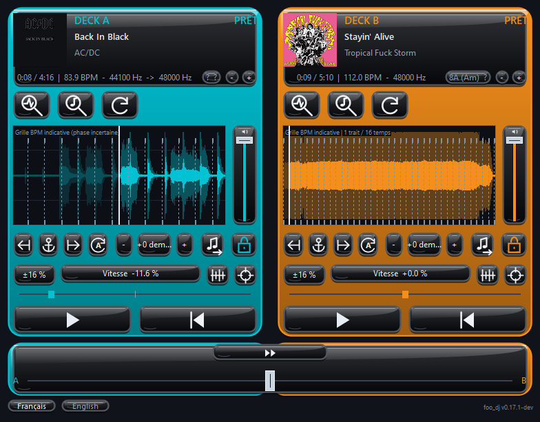

# DJ Decks 0.17.1-alpha.1 — experimental prerelease

New since 0.15.0-alpha.1:
- **Glossy cyan/orange interface, raised black icon buttons and bilingual hover tooltips.**
- **Automatic harmonic key matching** with the nearest transposition, without changing
  tempo. Same-mode keys match exactly; opposite modes target the relative major/minor.
- **Tag-writing conflict fix:** analysis pauses/releases every deck reading the same file.
  After saving/cancelling the analyser, press **Play** to reopen at the retained position.
- **Refresh tags feedback:** fresh file BPM/database key values, raw vs effective BPM.
- Compact aligned controls, larger icons, rounded molded rims, reflections and shadows.

User-supplied screenshot from 0.17.1-dev; same UI in this public alpha.

Install the **win-x64.fb2k-component** asset via Preferences → Components → Install.
Complete matching source and dependencies: **source.zip**. Distribute it alongside
the component. SHA-256 hashes: **SHA256SUMS.txt**.

[Detailed changelog including unpublished milestones](https://github.com/thomasandro/foobar-dj-decks/blob/main/CHANGELOG.md)
· [Français](https://github.com/thomasandro/foobar-dj-decks/blob/main/README.fr.md)

**Experimental, unsigned, Windows x64 / foobar2000 2.x / Default UI.**
Native tests include harmonic matching, reader release/position retention, control geometry
and offscreen graphics, plus 30 synthetic audio duration/frequency cases.
The user approved the appearance; clean-profile installation, live tag-writing regression,
tooltip behavior across environments, real-music quality and extended shutdown/unload
checks remain pending. No limiter/headphone cue; automatic beat SYNC is still experimental.
Slow shutdown has been observed and remains under investigation.

[Known issues](https://github.com/thomasandro/foobar-dj-decks/blob/main/docs/KNOWN_ISSUES.md)
· [Validation](https://github.com/thomasandro/foobar-dj-decks/blob/main/docs/VALIDATION.md)
