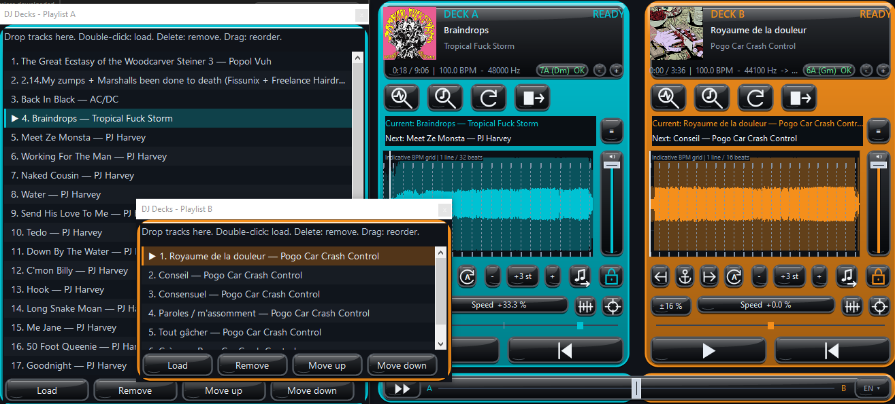

# DJ Decks 0.20.0-alpha.1 — experimental prerelease

New since 0.18.0-alpha.1:

- **Saved playlists on each deck:** two-line Current/Next previews and independent floating windows. Drop multiple tracks/albums in order, reorder/remove selections and double-click to load. Removing entries never deletes music files or interrupts the loaded track.
- **Matching playlist appearance:** dark alternating rows, cyan/orange selection accents and glossy black buttons with hover/press feedback.
- **AUTO playback:** independent auto-next on each deck, or alternating A1 → B1 → A2 → B2, preparing the silent deck's next track. If one list ends, the other finishes its remaining entries.
- **Configurable A/B crossfade:** 0, 1, 2, 3, 5, 8, 10, 15, 20 or 30 seconds; equal-power or linear curve. Fade time follows output audio frames and suspends during pause/output stalls. End triggering accounts for deck speed.

Thanks to **[StyxCrosser](https://hydrogenaudio.org/index.php/topic,130167.msg1090621.html#msg1090621)**, who suggested:
> A small (pop-up) playlist of some kind would be nice.

The playlist work follows that suggestion and the earlier UI/file-release feedback.

*User-supplied playlist screenshot, reused unchanged; the AUTO menu is not shown.*

Install the **win-x64.fb2k-component** asset via Preferences → Components → Install.
Matching complete sources/dependencies: **source.zip**. SHA-256: **SHA256SUMS.txt**.

[Detailed changelog, including unpublished milestones](https://github.com/thomasandro/foobar-dj-decks/blob/v0.20.0-alpha.1/CHANGELOG.md) · [Playlist guide](https://github.com/thomasandro/foobar-dj-decks/blob/v0.20.0-alpha.1/docs/PLAYLISTS.md) · [AUTO guide](https://github.com/thomasandro/foobar-dj-decks/blob/v0.20.0-alpha.1/docs/AUTOMATIC_PLAYBACK.md)

**Experimental, unsigned; Windows x64 / foobar2000 2.x / Default UI.**
Build and native tests passed: actual automatic controller, fade clocks/curves,
playlist persistence/reordering, themed windows/layout and 30 synthetic audio cases.
Same-deck auto-next is not gapless. Live transition quality, clean-profile installation,
long runtime and shutdown/unload checks remain pending. No limiter/headphone cue;
beat SYNC remains experimental. Slow shutdown remains under investigation.
This publication did not open, install into, monitor or capture foobar.
